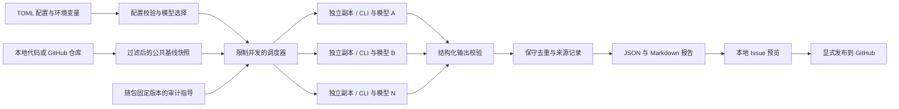
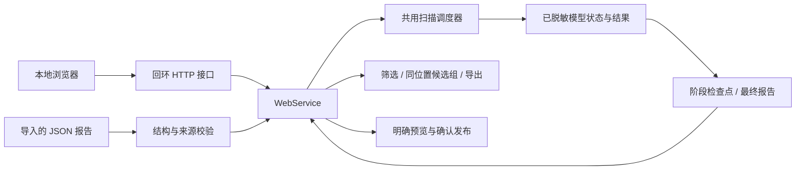

# 架构与执行流程

autoreviewer 是 code agent CLI 编排器，提供命令行和本地浏览器两个入口，复用配置校验、代码快照、进程调度和报告模块。它不安装模型、不绕过平台额度，也不自行判定漏洞已经复现。



## 配置对象

`providers` 保存平台地址、协议及密钥环境变量名。`models` 为每个审计实例指定唯一 ID、平台、模型 ID 和 adapter。`agents` 可以覆盖 CLI 的命令。`scan` 约束并发、超时和输出大小。`github` 配置目标仓库和发布 token 的变量名。

模型通过配置中的 `id` 区分，因此同一模型也可以通过不同平台或 CLI 运行。密钥在运行时读取，不写入 TOML。

## 本地浏览器入口

`web.py` 只监听回环地址，处理静态资源与 JSON API，并检查 Host、Origin 和会话请求令牌。`webservice.py` 管理非敏感配置、内存凭据、扫描工作线程、任务历史和 Issue 预览。每次扫描捕获独立的配置与凭据快照，不修改进程全局环境；后续配置变化不会替换正在运行实例的模型或密钥。



单个服务同时执行一个扫描任务，任务内部仍按配置并行启动多个 CLI。`state_lock.py` 用进程生命周期的操作系统文件锁约束同一数据目录只有一个写入者；锁在读取和恢复历史前取得，防止第二个服务将仍在执行的任务误判为中断。锁文件保留，进程退出后由操作系统释放锁。该约束不提供多用户认证或 CLI 沙箱。

## 一次扫描

1. 校验配置与目标，获取远程代码或读取本地目录。
2. 创建公共基线快照，再为每个模型准备独立副本。符号链接、常见密钥文件、Git 元数据和 agent 项目配置不进入快照。
3. 创建独立 HOME、状态目录和 CLI 配置，将随包附带的审计指导加入统一提示词。子进程只获取所需的运行环境及当前模型密钥。
4. 在并发限制内启动进程。单个实例失败不阻止其他实例，超时和输出过量作为失败记录。
5. 提取最终回答，校验 JSON、文件路径、行号和必需字段。格式错误与有效的空发现列表具有不同状态。
6. 合并指纹完全匹配的发现，保留模型来源和原始观察，输出报告及每个实例的结果。

在仓库根目录扫描时，快照尊重 Git 对未跟踪文件的忽略规则；已跟踪文件仍可审计。快照还会跳过二进制文件及大于 2 MiB 的文件；超过总量 100 MiB 或 20,000 个文件时会报错。过滤会缩小实际审计范围。大仓库可以配置额外排除规则，或先选定相关子目录。

报告的 `status` 为 `completed`、`partial` 或 `failed`。它表示运行完整性，不表示仓库是否安全。单个模型超时体现在该实例记录中。显式输出目录必须尚不存在，避免覆盖已有结果；不指定目录时使用 `.autoreviewer/runs/<UTC 时间戳>-<随机值>/`。

## 审计指导与来源

`guidance.py` 从包内固定版本的 Cloudflare 审计资料适配文本构建指导，嵌入内置 CLI 共用的审计提示词。自定义 CLI 通过 `{prompt}` 或 `AUTOREVIEWER_AUDIT_PROMPT` 接收，由包装程序负责传给模型。指导来自安装包，目标代码中的 `SKILL.md` 等文件不作为指导来源；原有的项目配置过滤和原生 skill 自动加载限制保持不变。

每个模型运行的 `audit_guidance` 保存上游来源与提交、适配模式与版本、指导摘要和完整提示词摘要。检查点、最终报告和历史导入保留已有记录；旧报告缺少该字段时不会补写当前版本。元数据记录主程序配置和交付的指导，不能证明自定义包装程序使用了提示词、模型遵守了指导或导入报告真实可信。

当前只引入 `guidance-readonly` 审查方法，不增加目标代码执行权限，不实现上游覆盖台账、独立验证器及完整审计流程。报告继续使用 autoreviewer 的发现格式，`verification` 固定为 `unverified`，`severity` 表示暂定影响评估。详细约定见 [审计指导说明](audit-guidance.md)。

## 阶段保存、恢复和重试

Web 任务在每个模型结束时原子替换 `checkpoint.json`，包含已经完成的发现和其他实例当时的状态；`job.json` 保存任务元数据与有界状态事件。运行中的 API 可返回带 `checkpoint: true` 的阶段报告。任务本身的 `running` 或 `cancelling` 状态，与阶段报告的完成程度分开表示，界面不能仅根据阶段发现数量宣称审计完成。

任务结束后写入 `report.json` 和 `report.md`，最终报告保存成功后清理检查点。重启时，终态任务读取最终报告；中断任务从有效检查点恢复已保存发现，将未完成实例改为 `interrupted`，并按成功实例数量形成部分或失败报告。不会自动运行未完成模型，也不能恢复尚未保存的模型回答。原子替换避免读到半写入文件，但没有对断电后的落盘持久性作保证。写入失败会保留内存结果并显示保存错误。

重试是新扫描，不是原进程续跑。新任务用 `parent_job_id` 关联原任务，重新读取原目标和引用，并创建新快照。可以选择失败实例或全部实例；所选配置 ID、平台标识、模型名称与 CLI 必须仍与原任务匹配。并发、超时和凭据来自当前配置。原报告不会被修改，新旧快照的发现不会合并成一次扫描结果。

## 报告导入

`reportio.py` 校验导入报告的版本、类型、运行状态、模型来源、指纹和聚合发现的一致性。报告正文作为数据处理，不执行其中的目标路径、命令或配置。通过校验的文件以新的导入任务保存，保留来源标签；它可以查看和导出，但不能作为自动重试的输入。

结构校验不证明报告真实性或漏洞有效性，也不访问源码核对证据。显式标记的阶段报告需要先将未完成实例规范化为中断状态，再作为部分结果读取。导入不会触发模型请求或 GitHub 写入。

## 发现的数据约定

Agent 最终输出一个对象：

```json
{
  "findings": [
    {
      "title": "Untrusted input reaches a database query",
      "severity": "high",
      "file": "src/example.py",
      "line": 42,
      "cwe": "CWE-89",
      "description": "Describe the source, sink, and relevant conditions.",
      "evidence": "Quote the relevant code and explain the data flow.",
      "recommendation": "Use parameterized queries.",
      "confidence": "medium"
    }
  ]
}
```

文件名必须是快照内真实文件的相对路径，行号从 1 开始。`severity` 取 `critical`、`high`、`medium`、`low` 或 `info`；`confidence` 取 `high`、`medium` 或 `low`。没有发现时返回 `{"findings": []}`。供应商 token、完整源文件和无关 CLI 日志不应出现在最终回答中。

去重使用文件、行号、CWE 和规范化标题形成的稳定指纹。不同描述可能保留为两个候选问题，需要人工复核。报告保留模型来源和原始观察，所有发现的 `verification` 都是 `unverified`；模型一致性不会将问题升级为“已确认”。

界面的“同位置候选组”是独立的展示层：仅将相同文件、相同行号和相同非空 CWE 的记录关联起来；没有 CWE 的记录分别保留。组内显示模型集合与最高报告严重程度，但原始发现、指纹及逐条证据不变。这不是语义去重，也不能据此认定组内只有一个漏洞。选择发布仍以单条发现的指纹为单位。

## 发布边界

扫描不执行 Issue 发布。`publish` 默认只生成本地预览，`--yes` 才进行 GitHub API 请求。发布前检查仓库状态和已有指纹；已关闭的同指纹 Issue 也作为已存在处理。一次请求失败不能证明 token 有写权限。

Web 界面只允许终态任务生成发布预览，阶段结果需等待任务结束。预览绑定目标仓库、所选发现和配置版本；明确确认后才提交。导入和重试也遵守该边界，分组不会自动扩大选中的发布范围。

## 后续方向

- 建立固定 CLI 版本和真实平台的集成测试矩阵。
- 接入可选协议转换服务，明确流式输出和工具调用语义。
- 增加 SARIF、PR diff 与增量审计。
- 让复核阶段验证候选问题的调用路径及必要条件。
- 引入供应商级速率限制、预算和可恢复任务队列。
- 提供操作系统级隔离，明确可访问的文件和网络范围。
